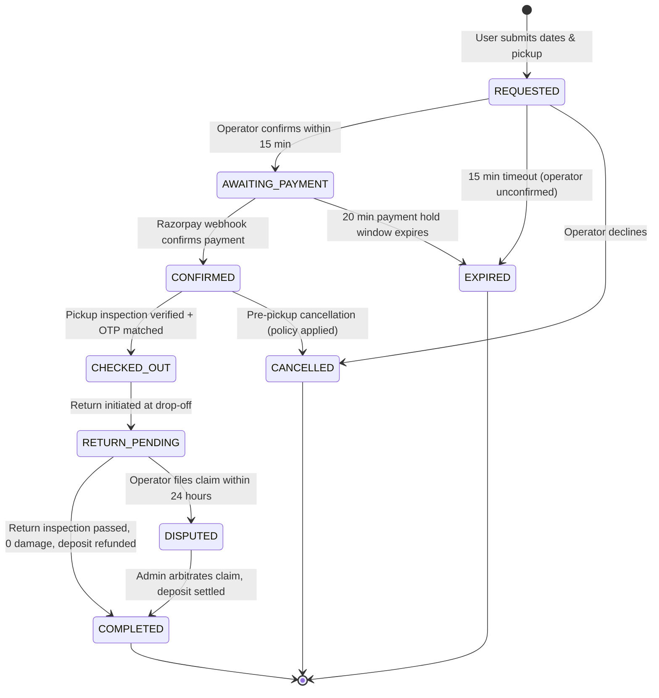
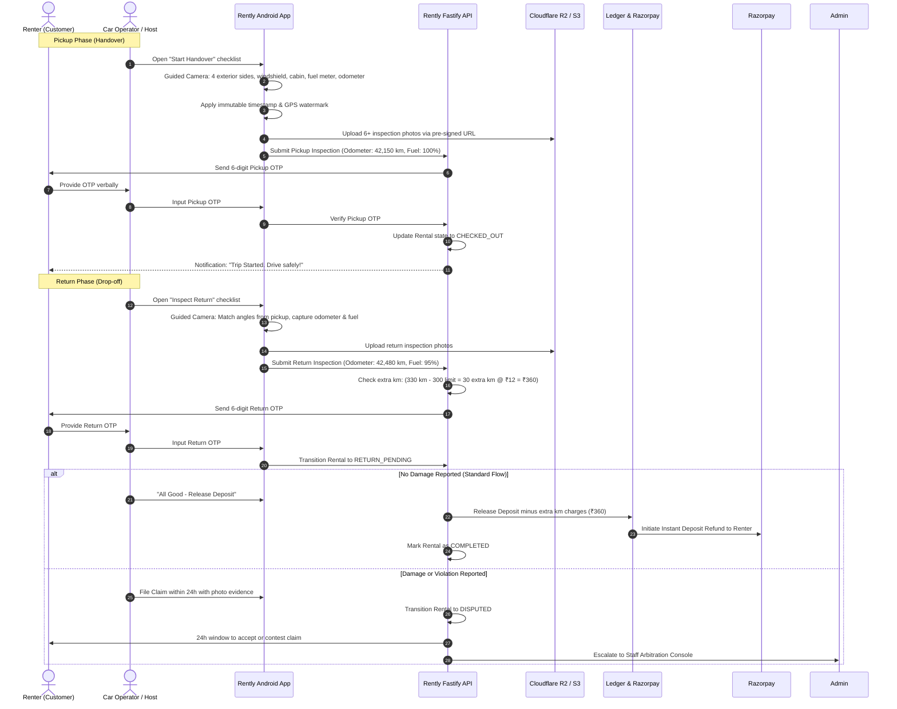
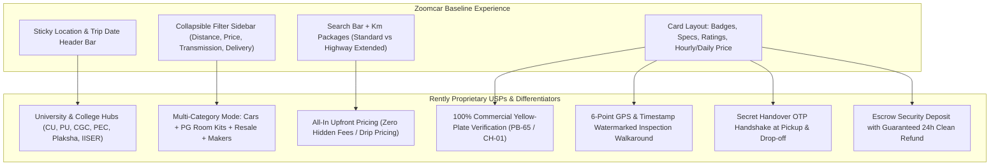
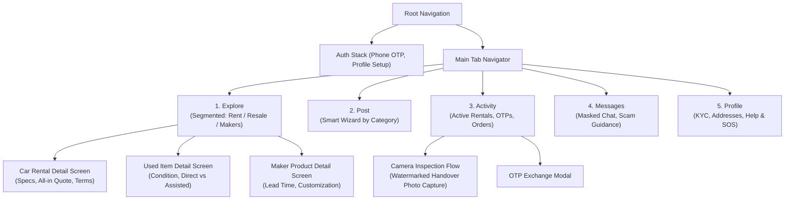
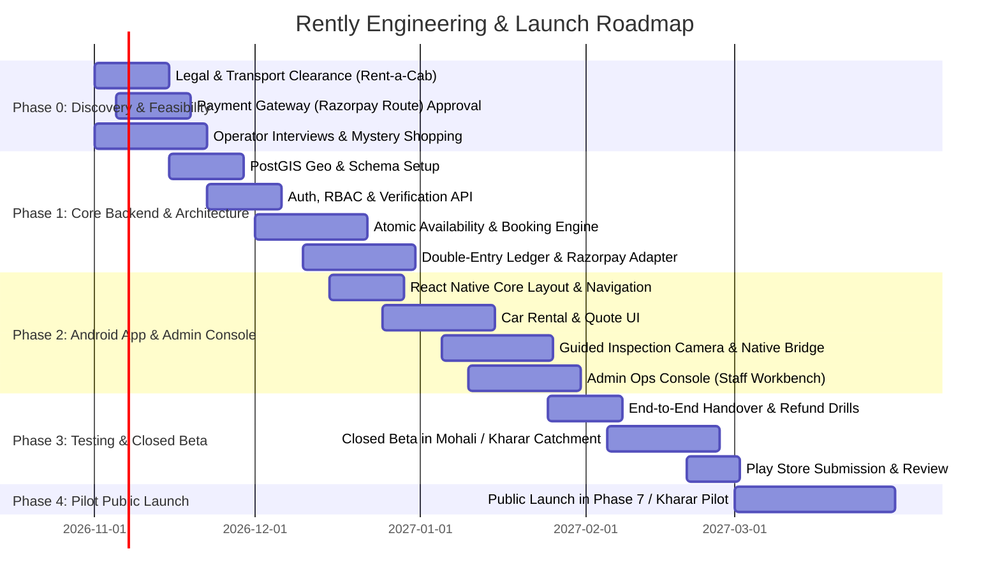

# Rently Application Creation & Engineering Plan
**Hyperlocal Rental & Commerce Platform (Mohali, Kharar, Chandigarh, Zirakpur)**  
*Derived from the Rently Hyperlocal Marketplace Business Plan (20 October 2026)*  
*Version: 1.0.0 | Status: Production Blueprint & Implementation Plan*

---

## 1. Executive Summary & Product Architecture

### 1.1 Product Vision & Core Hypothesis
Rently is an asset-light, geographically curated neighbourhood marketplace delivering dependable local transactions across three distinct modes:
1. **Rentals**: Focus on vetted self-drive car operators as the primary revenue engine, supplemented by high-demand non-car household and event assets (furniture, audio/visual gear).
2. **Buy Used (Resale)**: Fast, accountable secondhand item matching. Features dual-track transactions: free direct local deals and fee-based assisted transactions with payment protection, inspection checklist, and OTP handover.
3. **Made Nearby (Local Makers)**: Curated local artisanal crafts, custom goods, and gifts with clear lead-times, milestone tracking, and milestone-based advance deposits.

**Core Brand Promise**: *"Useful things nearby. Clear prices. People you can reach."*

### 1.3 University & College Campus Hyperlocal Strategy
The Tri-City and Kharar regions house over 150,000+ higher-education students across premier institutions and mega-campuses. Rently specifically targets these educational hubs as viral beachheads:

| Campus / Institution Hub | Primary Catchment & Student PGs | Specialized Student Job & Needs |
|---|---|---|
| **Chandigarh University (CU)** | Gharuan, Kharar-Kurali Highway, Kharar Town | PG room setups (coolers, desks, mattresses), semester-end resale, weekend road-trip cars |
| **Panjab University (PU)** | Sectors 14 & 25 Chandigarh, Sector 15 PG hub | Textbook exchanges, bicycle/scooter rentals, hostel room furniture, library laptops |
| **Punjab Engineering College (PEC)** | Sector 12 Chandigarh, Naya Gaon | Tech hardware, monitors, project tools, group travel vehicle rentals |
| **CGC Landran & CGC Jhanjeri** | Landran Road, Sector 71 Mohali, Chajju Majra | High-density PG setups, shared appliances (induction, kettles), moving day clearance |
| **Knowledge City (ISB, IISER, NIPER)** | Sector 81 & Sector 67 Mohali | Short-term researcher stays, premium furniture rentals, weekend city mobility |
| **Plaksha University** | IT City Mohali, Sector 101 | Maker gear, robotics/electronics equipment, modern apartment setup |
| **Chitkara University & Rayat Bahra** | Banur/Rajpura corridor & Kharar-Ropar road | Transit rentals, student luggage storage, verified campus-to-campus peer trading |

#### Student-Centric Features:
1. **Campus Safe Handover Spots**: Geo-tagged verified meetup points (e.g. *CU Gate 2*, *PU Stu-C (Student Centre)*, *CGC Landran Admin Block*, *Sector 15 Market Fountain*).
2. **Student Verified ID Badge**: `.edu` / university email or college photo ID tokenization granting:
   - 50% discount on security deposits for verified campus furniture packages.
   - 0% commission on direct textbook and academic gear sales.
   - Student group rates on vetted self-drive car rentals for weekend Himachal/Uttarakhand trips.
3. **Semester Starter Bundles**: Pre-packaged rental kits: *The PG Essentials Kit* (Study Desk + Ergonomic Chair + Table Fan/Heater + Kettle) at flat monthly student rates with free move-in delivery.
4. **"Pass-it-On" Semester Clearance**: Fast peer-to-peer liquidation where graduating seniors pass items directly to incoming juniors within their exact hostel or campus zone.

### 1.2 System Architecture Overview

```mermaid
graph TB
    subgraph Client Layer
        MobileApp["Android Mobile App\n(React Native + TypeScript)"]
        WebCatalog["Public Web Catalog\n(Next.js SEO / Web View)"]
        AdminWeb["Ops & Supplier Console\n(React + Vite Admin SPA)"]
    end

    subgraph API Gateway & Edge Layer
        Cloudflare["Cloudflare Edge\n(DDoS, SSL, CDN, WAF)"]
        APIGateway["Fastify Node.js / TypeScript Gateway\n(JWT, Rate Limiting, RBAC)"]
    end

    subgraph Core Domain Services (Modular Monolith)
        AuthService["Identity & Verification Service\n(Phone OTP, KYC, Driver License)"]
        GeoService["Geo & Serviceability Engine\n(PostGIS, Catchments, Zones)"]
        CatalogService["Catalog & Inventory Service\n(Rentals, Cars, Used, Makers)"]
        BookingService["Rental & Booking Engine\n(Atomic Hold, Availability, Calendar)"]
        OrderService["Commerce & Order Engine\n(Assisted Resale, Maker Milestones)"]
        InspectionService["Inspection & Handover Service\n(Watermarked Photo Proof, OTP)"]
        LedgerService["Ledger & Payments Service\n(Double-Entry, Razorpay Route)"]
        DisputeService["Disputes & Moderation Service\n(Claims, Arbitrations, Tickets)"]
    end

    subgraph Data & Storage Layer
        Postgres[("PostgreSQL 16 + PostGIS\nPrimary Relational Database")]
        RedisCache[("Redis 7.2 Cluster\nSession, Atomic Locks, Cache")]
        JobQueue["BullMQ Worker Queue\n(Hold Expiry, Webhooks, SMS)"]
        ObjectStore[("S3 / Cloudflare R2\nEncrypted Evidence Photos & Docs")]
    end

    subgraph External Provider Integrations
        Razorpay["Razorpay Route\n(Escrow, Payouts, Splits)"]
        FCM["Firebase Cloud Messaging\n(Push Notifications)"]
        SMS["SMS / WhatsApp Gateway\n(Twilio / Gupshup / Exotel)"]
        DigiLocker["Govt ID / DigiLocker Partner\n(License & RC Verification)"]
    end

    MobileApp --> Cloudflare
    WebCatalog --> Cloudflare
    AdminWeb --> Cloudflare
    Cloudflare --> APIGateway

    APIGateway --> AuthService
    APIGateway --> GeoService
    APIGateway --> CatalogService
    APIGateway --> BookingService
    APIGateway --> OrderService
    APIGateway --> InspectionService
    APIGateway --> LedgerService
    APIGateway --> DisputeService

    BookingService --> Postgres
    BookingService --> RedisCache
    BookingService --> JobQueue
    OrderService --> Postgres
    LedgerService --> Postgres
    InspectionService --> ObjectStore
    GeoService --> Postgres

    LedgerService --> Razorpay
    AuthService --> SMS
    AuthService --> DigiLocker
    BookingService --> FCM
```

---

## 2. Technology Stack & Repository Structure

### 2.1 Recommended Technology Stack

| Component | Selected Technology | Rationale & Requirements |
|---|---|---|
| **Mobile App** | **React Native (v0.74+) with TypeScript** | Single codebase for Android-first launch, easily extensible to iOS. Native bridge modules for secure camera capture, image compression, and watermarking. |
| **Web Catalog & SEO** | **Next.js (App Router) + Tailwind CSS** | Server-side rendering (SSR) for local landing pages, SEO-indexed listings, deep linking, and Play Store web-first conversion funnels. |
| **Admin & Ops Portal** | **React + Vite + Shadcn UI** | High-productivity desktop portal for operators, verification agents, support staff, and dispute arbitration. |
| **Backend API** | **Node.js (LTS) with Fastify & TypeScript** | High throughput, sub-millisecond JSON schema serialization, strict typing across shared models with mobile client. |
| **Database & Spatial** | **PostgreSQL 16 + PostGIS extension** | Native spatial polygon queries (`ST_Contains`, `ST_DWithin`), ACID transaction isolation, and GiST exclusion constraints for atomic date-range booking. |
| **Cache & Queue** | **Redis 7.2 + BullMQ** | Atomic reservation locking (`SET NX EX`), reservation hold TTL expiry timers, idempotent webhook processing queues. |
| **Object Storage** | **Cloudflare R2 or AWS S3** | Encrypted S3-compatible object store with time-limited pre-signed URLs for vehicle/item handover photos and identity documents. |
| **Payment Gateway** | **Razorpay Route (Marketplace)** | Split payouts, seller account onboarding, refundable security deposit holds, GSTR-8 compliant transaction reporting. |
| **Authentication** | **Custom JWT + Phone OTP via SMS Provider** | Passwordless login via SMS OTP (Exotel / Msg91 / Twilio); optional DigiLocker / Aadhaar tokenized verification for high-value car bookings. |

### 2.2 Monorepo Layout (`pnpm` Workspaces)

```
rently/
├── apps/
│   ├── mobile/                 # React Native Android client
│   │   ├── src/
│   │   │   ├── components/     # Atomic UI components
│   │   │   ├── features/       # Modular features: auth, rentals, cars, resale, makers, inspection
│   │   │   ├── navigation/     # React Navigation (BottomTabs, Stacks)
│   │   │   ├── services/       # API clients, offline sync, camera watermarking
│   │   │   └── store/          # Zustand state management
│   │   └── android/            # Native Android project configuration
│   ├── web-catalog/            # Next.js customer public browsing & web listing pages
│   └── admin-portal/           # Vite + React Staff operations & Operator console
├── packages/
│   ├── api-client/             # Generated TypeScript OpenAPI/tRPC client
│   ├── shared-types/           # Common domain types, enums, DTOs, state machine definitions
│   ├── validation/             # Zod validation schemas shared between client and server
│   └── ui-kit/                 # Shared design tokens, color palette, icons
├── services/
│   └── api/                    # Modular Monolith Fastify Backend
│       ├── src/
│       │   ├── core/           # Database, Redis, Logger, Config, Middleware
│       │   ├── domains/        # Domain modules (accounts, geo, catalog, bookings, ledger, etc.)
│       │   ├── workers/        # BullMQ background workers (booking expiry, payouts, reminders)
│       │   └── migrations/     # Prisma / Kysely / PostGIS database migrations
├── docker/                     # Docker Compose for local PostgreSQL+PostGIS, Redis, MinIO
└── docs/                       # API specs, runbooks, regulatory checklists
```

---

## 3. Data Modeling & Database Schema (PostgreSQL + PostGIS)

### 3.1 Geographical Entities & Serviceability

```sql
-- Geographical Jurisdictions (Punjab, Chandigarh UT, Haryana)
CREATE TABLE jurisdictions (
    id UUID PRIMARY KEY DEFAULT gen_random_uuid(),
    code VARCHAR(10) UNIQUE NOT NULL, -- 'PB', 'CH', 'HR'
    name VARCHAR(100) NOT NULL,
    tax_rules JSONB NOT NULL DEFAULT '{}',
    is_active BOOLEAN NOT NULL DEFAULT true
);

-- Service Zones (Polygons for Mohali, Kharar, Chandigarh Sectors, Zirakpur)
CREATE TABLE service_zones (
    id UUID PRIMARY KEY DEFAULT gen_random_uuid(),
    jurisdiction_id UUID REFERENCES jurisdictions(id),
    name VARCHAR(100) NOT NULL,
    slug VARCHAR(100) UNIQUE NOT NULL,
    boundary GEOMETRY(Polygon, 4326) NOT NULL,
    pickup_allowed BOOLEAN NOT NULL DEFAULT true,
    delivery_allowed BOOLEAN NOT NULL DEFAULT false,
    delivery_base_fee NUMERIC(10, 2) DEFAULT 0.00,
    is_active BOOLEAN NOT NULL DEFAULT true,
    created_at TIMESTAMPTZ NOT NULL DEFAULT NOW()
);
CREATE INDEX idx_service_zones_boundary ON service_zones USING GIST (boundary);
```

### 3.2 Users, Suppliers & Tiered Verification

```sql
CREATE TYPE user_role AS ENUM ('CUSTOMER', 'SELLER', 'CAR_OPERATOR', 'STAFF_AGENT', 'ADMIN');
CREATE TYPE verification_level AS ENUM ('UNVERIFIED', 'PHONE_VERIFIED', 'ID_CHECKED', 'BUSINESS_CHECKED', 'VEHICLE_CHECKED');

CREATE TABLE users (
    id UUID PRIMARY KEY DEFAULT gen_random_uuid(),
    phone_number VARCHAR(15) UNIQUE NOT NULL,
    full_name VARCHAR(150),
    email VARCHAR(255) UNIQUE,
    role user_role NOT NULL DEFAULT 'CUSTOMER',
    verification_level verification_level NOT NULL DEFAULT 'PHONE_VERIFIED',
    is_active BOOLEAN NOT NULL DEFAULT true,
    created_at TIMESTAMPTZ NOT NULL DEFAULT NOW()
);

CREATE TABLE supplier_businesses (
    id UUID PRIMARY KEY DEFAULT gen_random_uuid(),
    user_id UUID REFERENCES users(id) ON DELETE RESTRICT,
    business_name VARCHAR(200) NOT NULL,
    legal_entity_type VARCHAR(50) NOT NULL, -- 'INDIVIDUAL', 'PROPRIETORSHIP', 'LLP', 'PVT_LTD'
    gstin VARCHAR(15),
    pan_number VARCHAR(10),
    razorpay_account_id VARCHAR(100), -- Linked Razorpay Route Account
    payout_bank_details JSONB, -- Encrypted at rest
    operating_jurisdiction_id UUID REFERENCES jurisdictions(id),
    is_verified BOOLEAN NOT NULL DEFAULT false,
    created_at TIMESTAMPTZ NOT NULL DEFAULT NOW()
);

-- Document Verifications (Privacy-compliant: store tokens/hashes, not raw unmasked Aadhaar)
CREATE TABLE verifications (
    id UUID PRIMARY KEY DEFAULT gen_random_uuid(),
    target_type VARCHAR(50) NOT NULL, -- 'USER_ID', 'DRIVING_LICENSE', 'VEHICLE_RC', 'BUSINESS_GST'
    target_id UUID NOT NULL,
    document_type VARCHAR(50) NOT NULL,
    masked_identifier VARCHAR(50) NOT NULL, -- e.g. "DL-XXXXXXXX1234"
    status VARCHAR(30) NOT NULL DEFAULT 'PENDING', -- 'PENDING', 'APPROVED', 'REJECTED', 'EXPIRED'
    verified_by UUID REFERENCES users(id),
    verified_at TIMESTAMPTZ,
    expires_at TIMESTAMPTZ,
    metadata JSONB DEFAULT '{}',
    created_at TIMESTAMPTZ NOT NULL DEFAULT NOW()
);
```

### 3.3 Listings, Categories & Vehicle Assets

```sql
CREATE TYPE transaction_mode AS ENUM ('RENT', 'BUY_USED', 'MAKER');

CREATE TABLE listings (
    id UUID PRIMARY KEY DEFAULT gen_random_uuid(),
    supplier_id UUID REFERENCES supplier_businesses(id),
    created_by_user_id UUID REFERENCES users(id),
    mode transaction_mode NOT NULL,
    title VARCHAR(255) NOT NULL,
    description TEXT NOT NULL,
    category_id UUID NOT NULL,
    condition_grade VARCHAR(50), -- 'BRAND_NEW', 'LIKE_NEW', 'GOOD', 'FAIR'
    primary_image_url TEXT NOT NULL,
    gallery_image_urls TEXT[] NOT NULL DEFAULT '{}',
    location GEOMETRY(Point, 4326) NOT NULL,
    service_zone_id UUID REFERENCES service_zones(id),
    base_price NUMERIC(10, 2) NOT NULL, -- Daily rent, outright sale price, or base craft price
    security_deposit NUMERIC(10, 2) DEFAULT 0.00,
    is_active BOOLEAN NOT NULL DEFAULT true,
    is_available BOOLEAN NOT NULL DEFAULT true,
    attributes JSONB NOT NULL DEFAULT '{}',
    created_at TIMESTAMPTZ NOT NULL DEFAULT NOW()
);
CREATE INDEX idx_listings_location ON listings USING GIST (location);

-- Dedicated Fleet Assets for Vetted Car Rentals
CREATE TABLE vehicles (
    id UUID PRIMARY KEY DEFAULT gen_random_uuid(),
    listing_id UUID UNIQUE REFERENCES listings(id) ON DELETE CASCADE,
    supplier_id UUID REFERENCES supplier_businesses(id),
    make VARCHAR(50) NOT NULL,
    model VARCHAR(50) NOT NULL,
    year INT NOT NULL,
    registration_number VARCHAR(20) UNIQUE NOT NULL,
    permit_type VARCHAR(50) NOT NULL, -- 'RENT_A_CAB_COMMERCIAL'
    permit_valid_until DATE NOT NULL,
    insurance_policy_number VARCHAR(100) NOT NULL,
    insurance_valid_until DATE NOT NULL,
    insurance_covers_self_drive BOOLEAN NOT NULL DEFAULT false,
    puc_valid_until DATE NOT NULL,
    fuel_type VARCHAR(30) NOT NULL, -- 'PETROL', 'DIESEL', 'CNG', 'EV'
    transmission VARCHAR(20) NOT NULL, -- 'MANUAL', 'AUTOMATIC'
    seating_capacity INT NOT NULL,
    current_odometer_km INT NOT NULL DEFAULT 0,
    daily_km_limit INT NOT NULL DEFAULT 250,
    extra_km_charge NUMERIC(6, 2) NOT NULL DEFAULT 12.00,
    created_at TIMESTAMPTZ NOT NULL DEFAULT NOW()
);
```

### 3.4 Atomic Availability & Double-Booking Prevention

```sql
-- PostgreSQL extension btree_gist enables GiST exclusion constraints on date/time ranges
CREATE EXTENSION IF NOT EXISTS btree_gist;

CREATE TABLE availability_blocks (
    id UUID PRIMARY KEY DEFAULT gen_random_uuid(),
    listing_id UUID REFERENCES listings(id) ON DELETE CASCADE,
    block_type VARCHAR(30) NOT NULL, -- 'BOOKING', 'MAINTENANCE_BUFFER', 'MANUAL_HOLD'
    time_range TSTZRANGE NOT NULL,
    reservation_id UUID, -- References reservations(id) once created
    created_at TIMESTAMPTZ NOT NULL DEFAULT NOW(),
    -- Atomic prevention of double-booking overlapping date/times for the same listing
    EXCLUDE USING GIST (listing_id WITH =, time_range WITH &&)
);
```

### 3.5 Rental Reservations, Handover Inspections & Claims

```sql
CREATE TYPE rental_status AS ENUM (
    'REQUESTED',
    'AWAITING_PAYMENT',
    'CONFIRMED',
    'CHECKED_OUT',
    'RETURN_PENDING',
    'COMPLETED',
    'DISPUTED',
    'CANCELLED',
    'EXPIRED'
);

CREATE TABLE rentals (
    id UUID PRIMARY KEY DEFAULT gen_random_uuid(),
    listing_id UUID REFERENCES listings(id),
    renter_user_id UUID REFERENCES users(id),
    supplier_id UUID REFERENCES supplier_businesses(id),
    status rental_status NOT NULL DEFAULT 'REQUESTED',
    start_time TIMESTAMPTZ NOT NULL,
    end_time TIMESTAMPTZ NOT NULL,
    pickup_mode VARCHAR(20) NOT NULL DEFAULT 'SELF_PICKUP', -- 'SELF_PICKUP', 'DELIVERY'
    
    -- Exact itemized pricing breakdown snapshot
    quote_snapshot JSONB NOT NULL,
    base_rent_amount NUMERIC(10, 2) NOT NULL,
    security_deposit_amount NUMERIC(10, 2) NOT NULL DEFAULT 0.00,
    delivery_fee NUMERIC(10, 2) NOT NULL DEFAULT 0.00,
    platform_commission_amount NUMERIC(10, 2) NOT NULL,
    total_paid NUMERIC(10, 2) NOT NULL,
    
    -- Verification codes for physical handovers
    pickup_otp VARCHAR(6),
    return_otp VARCHAR(6),
    
    created_at TIMESTAMPTZ NOT NULL DEFAULT NOW()
);

-- Inspection Evidence for Audited Pickups & Returns
CREATE TABLE inspections (
    id UUID PRIMARY KEY DEFAULT gen_random_uuid(),
    rental_id UUID REFERENCES rentals(id) ON DELETE CASCADE,
    inspection_type VARCHAR(20) NOT NULL, -- 'PICKUP', 'RETURN'
    conducted_by_user_id UUID REFERENCES users(id),
    checklist_answers JSONB NOT NULL,
    photo_urls TEXT[] NOT NULL, -- Minimum 6 angles for cars (4 sides, odometer, fuel)
    odometer_reading INT,
    fuel_level_fraction NUMERIC(3, 2), -- e.g. 0.75 for 3/4 tank
    geo_point GEOMETRY(Point, 4326) NOT NULL,
    timestamp_verified TIMESTAMPTZ NOT NULL DEFAULT NOW()
);

-- Claims & Deductions against Deposit
CREATE TABLE claims (
    id UUID PRIMARY KEY DEFAULT gen_random_uuid(),
    rental_id UUID REFERENCES rentals(id),
    filed_by_supplier_id UUID REFERENCES supplier_businesses(id),
    claimed_amount NUMERIC(10, 2) NOT NULL,
    damage_description TEXT NOT NULL,
    evidence_photo_urls TEXT[] NOT NULL,
    renter_response TEXT,
    renter_responded_at TIMESTAMPTZ,
    status VARCHAR(30) NOT NULL DEFAULT 'OPEN', -- 'OPEN', 'RESOLVED_APPROVED', 'RESOLVED_REJECTED', 'ARBITRATION'
    resolution_notes TEXT,
    deducted_deposit_amount NUMERIC(10, 2) DEFAULT 0.00,
    refunded_deposit_amount NUMERIC(10, 2) DEFAULT 0.00,
    created_at TIMESTAMPTZ NOT NULL DEFAULT NOW()
);
```

### 3.6 Resale & Maker Orders

```sql
-- Assisted Resale Transactions
CREATE TABLE assisted_resale_orders (
    id UUID PRIMARY KEY DEFAULT gen_random_uuid(),
    listing_id UUID REFERENCES listings(id),
    buyer_user_id UUID REFERENCES users(id),
    seller_user_id UUID REFERENCES users(id),
    agreed_price NUMERIC(10, 2) NOT NULL,
    assisted_fee NUMERIC(10, 2) NOT NULL, -- e.g. 5% (Min ₹99, Max ₹299)
    status VARCHAR(30) NOT NULL DEFAULT 'ESCROW_FUNDED', -- 'ESCROW_FUNDED', 'INSPECTED_PICKED_UP', 'DISPUTE_WINDOW_CLOSED', 'SETTLED'
    handover_otp VARCHAR(6) NOT NULL,
    handover_completed_at TIMESTAMPTZ,
    dispute_window_ends_at TIMESTAMPTZ, -- 48 hours after handover
    created_at TIMESTAMPTZ NOT NULL DEFAULT NOW()
);

-- Maker / Made Nearby Production Milestones
CREATE TABLE maker_orders (
    id UUID PRIMARY KEY DEFAULT gen_random_uuid(),
    listing_id UUID REFERENCES listings(id),
    buyer_user_id UUID REFERENCES users(id),
    maker_supplier_id UUID REFERENCES supplier_businesses(id),
    customization_specs JSONB NOT NULL DEFAULT '{}',
    production_lead_days INT NOT NULL,
    estimated_delivery_date DATE NOT NULL,
    total_amount NUMERIC(10, 2) NOT NULL,
    advance_deposit_amount NUMERIC(10, 2) NOT NULL,
    current_milestone VARCHAR(50) NOT NULL DEFAULT 'ORDER_CONFIRMED', -- 'ORDER_CONFIRMED', 'MATERIAL_SOURCED', 'IN_PRODUCTION', 'READY_FOR_DISPATCH', 'DELIVERED'
    milestone_history JSONB NOT NULL DEFAULT '[]',
    created_at TIMESTAMPTZ NOT NULL DEFAULT NOW()
);
```

### 3.7 Double-Entry Financial Ledger

```sql
CREATE TYPE account_type AS ENUM (
    'CUSTOMER_FUNDS_RECEIVABLE',   -- Gateway settlement asset
    'PLATFORM_COMMISSION_REVENUE', -- Platform earnings
    'SUPPLIER_PAYABLE',            -- Liability owed to operator/seller
    'DEPOSIT_ESCROW_LIABILITY',    -- Renter deposit held in trust
    'GATEWAY_FEE_EXPENSE',         -- Processing fees
    'REFUND_EXPENSE'               -- Outflows for cancelled bookings
);

CREATE TABLE ledger_accounts (
    id UUID PRIMARY KEY DEFAULT gen_random_uuid(),
    account_type account_type NOT NULL,
    supplier_id UUID REFERENCES supplier_businesses(id),
    user_id UUID REFERENCES users(id),
    balance NUMERIC(14, 2) NOT NULL DEFAULT 0.00,
    created_at TIMESTAMPTZ NOT NULL DEFAULT NOW()
);

CREATE TABLE ledger_entries (
    id UUID PRIMARY KEY DEFAULT gen_random_uuid(),
    transaction_id VARCHAR(100) NOT NULL, -- Grouping ID for double-entry bundle
    debit_account_id UUID REFERENCES ledger_accounts(id),
    credit_account_id UUID REFERENCES ledger_accounts(id),
    amount NUMERIC(12, 2) NOT NULL,
    reference_type VARCHAR(50) NOT NULL, -- 'RENTAL_PAYMENT', 'DEPOSIT_REFUND', 'SUPPLIER_SETTLEMENT'
    reference_id UUID NOT NULL,
    description TEXT NOT NULL,
    created_at TIMESTAMPTZ NOT NULL DEFAULT NOW()
);
CREATE INDEX idx_ledger_transaction_id ON ledger_entries(transaction_id);
```

---

## 4. State Machines & Critical Workflows

### 4.1 Car Rental Lifecycle State Machine



### 4.2 Car Pickup & Return Inspection Workflow



### 4.3 Atomic Date-Range Reservation Logic (PostgreSQL + Redis)

To prevent the catastrophic failure mode where two users simultaneously attempt to reserve the same vehicle or rental item for overlapping dates:

```typescript
// services/api/src/domains/bookings/booking.service.ts
import { FastifyInstance } from 'fastify';
import { db } from '../../core/database';
import { redis } from '../../core/redis';

export async function createRentalHold(
  listingId: string,
  renterId: string,
  startTime: Date,
  endTime: Date
): Promise<{ holdId: string; expiresAt: Date }> {
  const lockKey = `lock:listing:${listingId}`;
  const acquired = await redis.set(lockKey, renterId, 'PX', 5000, 'NX');
  if (!acquired) {
    throw new Error('Listing is currently undergoing booking by another user. Try again in a few seconds.');
  }

  try {
    return await db.transaction(async (trx) => {
      // 1. Check for overlapping blocks using PostgreSQL GiST range check
      const overlapping = await trx.query(
        `SELECT id FROM availability_blocks 
         WHERE listing_id = $1 
         AND time_range && tstzrange($2, $3, '[)')`,
        [listingId, startTime.toISOString(), endTime.toISOString()]
      );

      if (overlapping.rowCount > 0) {
        throw new Error('Vehicle is already booked for the selected date range.');
      }

      // 2. Insert temporary hold block (with a 20-minute expiry buffer)
      const holdExpiresAt = new Date(Date.now() + 20 * 60 * 1000);
      const result = await trx.query(
        `INSERT INTO availability_blocks (listing_id, block_type, time_range)
         VALUES ($1, 'MANUAL_HOLD', tstzrange($2, $3, '[)'))
         RETURNING id`,
        [listingId, startTime.toISOString(), endTime.toISOString()]
      );

      const holdId = result.rows[0].id;

      // 3. Schedule automatic hold release in Redis/BullMQ queue at holdExpiresAt
      await redis.set(`hold:expiry:${holdId}`, listingId, 'PX', 20 * 60 * 1000);

      return { holdId, expiresAt: holdExpiresAt };
    });
  } finally {
    // Release atomic mutex
    await redis.del(lockKey);
  }
}
```

---

## 5. UI/UX Architecture & Zoomcar-Calibrated Design

### 5.0 Zoomcar-Calibrated UX & Conversion Architecture (100% Visual Parity + Rently USPs)
To provide an industry-leading booking experience matching top automotive marketplace leaders like **Zoomcar** (`https://www.zoomcar.com/in/`), Rently adopts the proven high-conversion layout, search hierarchy, and filter architecture, while embedding our proprietary trust and campus USPs:



#### Detailed Visual Parity Mapping:
| Zoomcar Feature | Rently Implementation | Rently Value-Add / Differentiator |
|---|---|---|
| **Sticky Header Bar** | `[ 📍 Location Picker ] [ 📅 Pickup & Drop Dates ]` | Includes dedicated dropdown for **University Campuses** (CU, PU, CGC, PEC) and safe security gate meetup spots. |
| **Left Filter Sidebar** | Distance slider (0–30 km), Delivery type, Price Range, Fuel, Transmission, Seats | Adds **Student Verified Discount filter** (50% furniture deposit waiver, bonus km for campus trips). |
| **Search & Quick Pills** | `SUV`, `Home Delivery`, `Top Rated`, `0–10 km` | Adds `🎓 Semester Room Kits`, `🔄 Protected Resale`, `🎨 Local Makers`, `🛡️ Vetted Commercial Fleet`. |
| **Car Listing Card** | Hero photo with carousel dots, rating badge, price per hour/day | Adds **Yellow-Plate Permit badge**, **All-in GST & Escrow Deposit preview**, and **Campus delivery distance**. |
| **Handover Experience** | Host handover with unstandardized app photos | **Standardized 6-point guided silhouette camera** with on-device GPS/timestamp watermark and mutual OTP exchange. |

### 5.1 Navigation Structure (5 Primary Tabs)



### 5.2 Screen Specifications & Wireframe Definitions

#### Screen 1: Explore & Hyperlocal Filter Bar
- **Top Header**: Locality selector dropdown (e.g., *"Mohali Phase 7 (3.2 km)"* / *"Kharar Chajju Majra"* / *"Sector 35 Chandigarh"*), search icon, notification bell.
- **Segmented Control**:
  - `Rent` (Features prominent hero card: *"Self-Drive Cars from Verified Operators"* + Non-car essentials filter chips: Desks, Chairs, Projectors, Speakers).
  - `Buy Used` (Furniture, Electronics, PG moving essentials, Books).
  - `Made Nearby` (Handcrafted gifts, Art, Home decor with production lead-time badges).
- **Listing Card**:
  - Photo with condition pill badge (`Like New`, `Commercial Permit Verified`).
  - Distance badge: `2.4 km away · Sector 70`.
  - Transparent pricing: `₹1,800/day · 250 km included` or `₹2,500 outright`.
  - Operator badge: `Verified Local Partner · 4.9★ (42 trips)`.

#### Screen 2: Car Rental Quote & Request-to-Book Screen
- **Vehicle Summary**: Make, Model, Year, Transmission, Fuel Type, Seating Capacity.
- **Dates & Catchment**: Pickup date/time, Drop-off date/time, Delivery option (Self-pickup at Operator Hub vs Doorstep Drop ₹250).
- **Eligibility Screening**: Minimum age (21+), valid Driving License confirmation.
- **Transparent All-in Quote Breakdown**:
  ```
  Base Rent (2 days @ ₹1,800/day):       ₹3,600
  Included Kilometres:                   500 km (Extra: ₹12/km)
  Doorstep Delivery:                     ₹  250
  Taxes (GST @ 18% on service):          ₹  693
  Refundable Security Deposit:           ₹2,000 (Refunded within 24h of clean return)
  -----------------------------------------------
  Total Payable Now:                     ₹6,543
  ```
- **Operator Policy Accordion**: Fuel policy (Same-to-same), Interstate border permit rules (Punjab/Chandigarh/Haryana toll advice), Cancellation schedule.
- **CTA**: `"Request Booking (15-min Operator Confirmation)"`.

#### Screen 3: Guided Inspection Camera Screen (Android Native Bridge)
- **Guided Overlay**: Transparent silhouette guidelines for 6 mandatory angles:
  1. Front Bumper & Windshield
  2. Right Side & Tires
  3. Rear Bumper & Trunk
  4. Left Side & Tires
  5. Cabin & Seats
  6. Dashboard Odometer & Fuel Level
- **Anti-Fraud Controls**:
  - Live camera only (gallery upload disabled for vehicle handover).
  - Automatic dynamic watermarking burned into image bytes: GPS Coordinates (`30.7046° N, 76.7179° E`), Timestamp (`2026-10-20 14:30:15 IST`), Rental ID (`RNT-84920`).
  - Pre-upload image compression (WebP format, target size ~400KB per photo for high-speed upload even on 4G).

#### Screen 4: Activity & OTP Handover Card
- Persistent dynamic card displayed for active transactions:
  ```
  ┌──────────────────────────────────────────────┐
  │ 🚗 Active Booking: Hyundai Creta (PB65-XXXX) │
  │ Status: Handover Ready at Mohali Phase 7     │
  │                                              │
  │   YOUR PICKUP OTP:  [ 4 8 2 9 1 0 ]          │
  │                                              │
  │ ⚠️ Give this OTP to the operator ONLY after  │
  │ completing the joint vehicle photo inspection│
  │                                              │
  │ [ View Inspection Checklist ] [ Call Support]│
  └──────────────────────────────────────────────┘
  ```

---

## 6. Staff Operations & Admin Web Console

### 6.1 Essential Staff Operations Modules

1. **Operator & Vehicle Compliance Board**:
   - Queue for reviewing operator registrations, commercial Rent-a-Cab permits, insurance policies, and fitness certificates.
   - **Automated Pause Rule**: If insurance or PUC expires within 7 days, the system automatically flags the operator; on the exact expiry date, inventory is automatically unlisted from public search.
2. **Real-time Trip & SOS Monitoring**:
   - Active rental dashboard highlighting bookings currently on the road.
   - 24/7 breakdown assistance escalation button linking directly to operator towing contacts.
3. **Dispute & Claims Arbitration Workbench**:
   - Split-screen comparison displaying **Pickup Inspection Photos vs Return Inspection Photos** side-by-side with zoom and timestamp validation.
   - Claim settlement controls: Deduct ₹X from deposit, refund ₹Y to renter, submit arbitration summary.
4. **Ledger & Settlement Reconciliation**:
   - Daily comparison between Razorpay Route gateway settlements and internal double-entry ledger accounts.
   - Manual override approvals requiring two staff sign-offs for large refunds (> ₹5,000).

---

## 7. Security, Trust, Privacy & Legal Compliance

### 7.1 Digital Personal Data Protection (DPDP) 2025 Architecture
- **Purpose-Specific Consent**: Separate explicit consent captures for:
  - Phone number for transaction OTPs and critical alerts.
  - Location access (foreground only for nearest listings, never continuous background tracking).
  - Identity verification (DigiLocker tokenized ID lookup).
- **Aadhaar & ID Data Minimization**:
  - The application **never** stores raw, unmasked Aadhaar numbers or unredacted citizen cards.
  - For Driving Licenses, store only `verified_status = true`, `license_class`, `validity_date`, and a SHA-256 hash of the document number.
- **Automated Data Deletion Route**:
  - In-app Account Deletion button in Profile tab + public web deletion URL (compliant with Google Play policies).
  - Data purging engine removes user PII within 30 days, while isolating financial ledger and invoice records for the statutory 7-year GST/tax audit retention period in a secure, immutable archive.

### 7.2 E-Commerce 2027 Regulatory Readiness
- **Search Ranking Transparency**: Explicit disclosure of ranking parameters (proximity, availability, customer rating) with zero sponsored bias on car search results unless clearly marked with a `[Sponsored]` badge.
- **All-in Pricing Display**: Absolute ban on hidden drip pricing. The price seen on the search card represents the total base cost before optional delivery.
- **Grievance Redressal**:
  - In-app ticket routing with automated acknowledgment within 2 hours.
  - Display of statutory Grievance Officer details (name, email, phone, Mohali office address) accessible within 2 taps.

### 7.3 Google Play Store Policies & Payment Architecture
- **Physical Goods & Rental Exemption**: Rentals of physical vehicles, secondhand goods, and handcrafted products qualify as physical goods/services under Google Play's payments policy, allowing direct integration with Razorpay Route without the 15–30% Google Play In-App Billing fee.
- **User-Generated Content (UGC) Safeguards**:
  - Report and block buttons on every listing, user profile, and chat thread.
  - Automated regex and image filtering for prohibited items (weapons, drugs, counterfeit goods).

---

## 8. Phased Development Roadmap & Sprint Schedule



### Sprint Deliverables Breakdown

#### Phase 0: Regulatory Feasibility & Gateway Clearance (Weeks 1–3)
- [ ] Retain local Punjab transport legal counsel to review operator Rent-a-Cab documentation.
- [ ] Submit marketplace business model to Razorpay Route compliance for split-payout approval.
- [ ] Formulate GSTR-8 tax collection and unregistered supplier reporting matrix with local CA.
- [ ] Recruit first 5 vetted car operators in Mohali/Kharar for catalog commitments.

#### Phase 1: Foundational API & Ledger Engine (Weeks 4–7)
- [ ] Set up Fastify + PostgreSQL + PostGIS repository with automated migrations.
- [ ] Implement atomic date-range availability blocks with GiST exclusion constraints.
- [ ] Build Razorpay Route split payment, escrow deposit hold, and automated refund routines.
- [ ] Implement double-entry ledger bookkeeping tables and reconciliation checks.
- [ ] Build SMS OTP authentication and document verification tokenization service.

#### Phase 2: Android App & Ops Workbench (Weeks 8–11)
- [ ] Scaffold React Native Android project with native camera bridge for watermarked photo capture.
- [ ] Build 5-tab customer navigation (Explore, Post, Activity, Messages, Profile).
- [ ] Implement itemized car rental quote calculation and Request-to-Book 15-minute countdown timer.
- [ ] Implement joint pickup/return inspection checklist and OTP handshake screens.
- [ ] Build React + Vite Admin Console for operator onboarding, vehicle compliance, and dispute resolution.

#### Phase 3: Hardening, Drills & Closed Beta (Weeks 12–14)
- [ ] Conduct end-to-end simulation of worst-case failure modes:
  - Simultaneous booking attempts on the same car.
  - Network drop during inspection photo upload.
  - Operator vehicle damage claim dispute flow and deposit deductions.
  - Razorpay delayed webhook delivery and idempotency validation.
- [ ] Run closed beta test with 25 real transactions across Mohali Phase 7 and Kharar.
- [ ] Prepare Google Play Store listing, Data Safety disclosures, and public privacy policy.

#### Phase 4: Public Pilot Release & Operating Gates (Week 15+)
- [ ] Release Android app to Google Play Store in Mohali / Kharar 3–5 km initial polygon.
- [ ] Enforce Phase 1 operating gates: availability confirmation < 15 min, supplier cancellation < 5%, on-time handovers > 90%.

---

## 9. Failure Modes & Edge Case Engineering Playbook

| Failure Scenario | Technical & Operational Countermeasure |
|---|---|
| **Simultaneous Booking Race Condition** | Postgres GiST range exclusion (`EXCLUDE USING GIST (listing_id WITH =, time_range WITH &&)`) combined with Redis distributed mutex locks. The second requester receives a friendly: *"Vehicle was just reserved by another nearby renter."* |
| **Payment Completed but Network Disconnects Before App Receives Confirmation** | Never mark a booking as paid from the client app. Rely strictly on signed, idempotent Razorpay server-to-server webhooks (`payment.captured`). Booking status transitions asynchronously and updates client via Firebase Push Notification (FCM). |
| **Network Loss in Basement / Remote Area During Handover Inspection** | Android client stores inspection photos and checklist answers in encrypted local SQLite/WatermelonDB storage with offline timestamps. Background sync worker automatically uploads to Cloudflare R2 when device reconnects to 4G/Wi-Fi. |
| **Operator Attempts Unsubstantiated Deposit Deduction** | Deposit cannot be deducted unilaterally. The operator must file a formal claim within 24 hours with return inspection photos. The app holds funds in escrow and provides the renter a 24-hour response window. In case of dispute, human staff arbitrates using side-by-side pickup vs. return photos. |
| **Operator Documents Expire During Active Booking** | Nightly cron job checks vehicle permit, insurance, and fitness expiry. Expired assets are instantly unlisted from search, preventing new bookings. Bookings already confirmed prior to expiry are flagged for manual operator replacement verification. |
| **Seller Attempts to Take Transaction Off-Platform in Chat** | Chat service runs client-side and server-side regex detection on phone numbers and UPI IDs (`@okhdfcbank`, `@paytm`). Displays non-intrusive safety warning: *"⚠️ Transactions outside Rently are not protected by our inspected handover and deposit refund guarantee."* |

---

## 10. Next Immediate Action Items

1. **Initialize Codebase**: Run repository scaffolding script with Fastify, React Native, PostgreSQL, and PostGIS.
2. **Execute Operator Mystery Shopping**: Inspect and record 5 local self-drive car rental workflows across Mohali and Chandigarh to benchmark current operational gaps.
3. **Draft Legal Responsibility Matrix**: Coordinate with legal advisor to finalize customer terms, operator self-drive agreements, and DPDP privacy notices.
4. **Deploy Phase 0 Landing Page**: Deploy Next.js public waitlist and SEO catalog page targeting *"Self drive car rental Mohali & Kharar"* to measure pre-launch demand.
