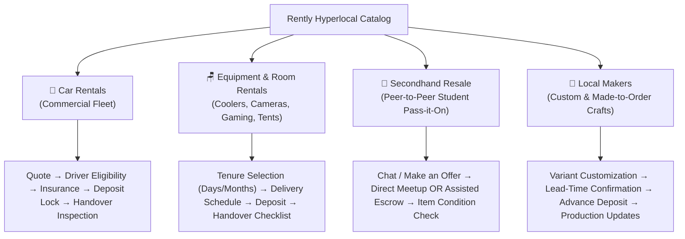
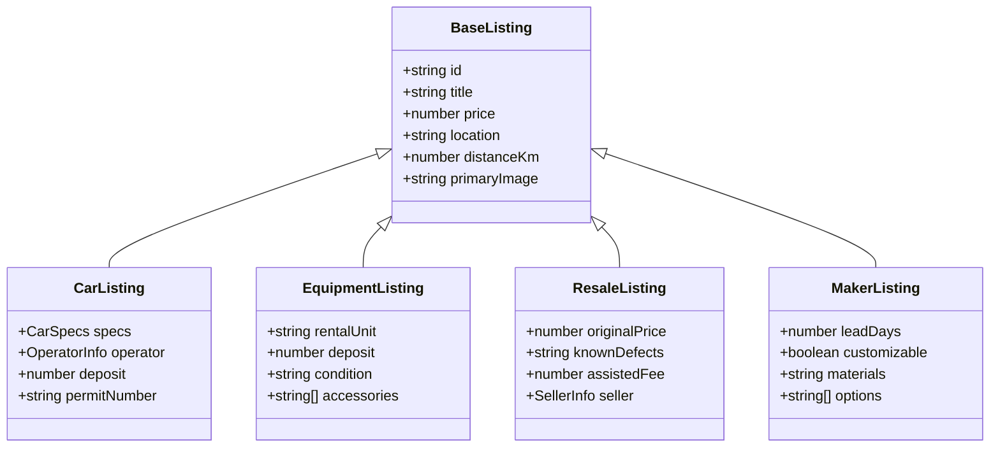
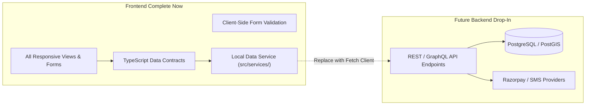

# Rently Frontend Architecture & Phased Improvement Plan
**Hyperlocal Rental & Commerce Platform (Chandigarh, Mohali, Kharar, Zirakpur)**  
*Document Version: 1.0.0 | Date: 20 October 2026 | Status: Ready for Review & Approval*

---

## 1. Executive Summary & Frontend Diagnosis

### 1.1 Context & Objective
Rently has established a strong visual identity: a clean, responsive, Apple-inspired interface featuring a custom 4-block search dock, category carousels, a persistent mobile bottom tab bar, and a thoughtful color palette (light/dark appearance).

However, as highlighted by our functional audit, the frontend currently operates as a **presentation-first prototype** rather than a **transaction-complete commerce experience**. Crucial customer journeys are incomplete, checkout flows leak across categories, routing is coarse, and state is largely held in non-persistent React memory.

The objective of this plan is to elevate Rently’s frontend to the **completeness, predictability, and navigational maturity of a leading commerce platform (e.g. Flipkart)**, adapted to hyperlocal rentals and peer-to-peer commerce, while strictly preserving Rently’s restrained, Apple-grade design language.

```
       [ Commercial Polish & Utility (Flipkart-grade) ]
                         ▲
                         │
             Mature Commerce Patterns:
             • Predictable filtering & faceted search
             • Explicit item comparison & specs
             • Real order timelines & status views
             • Separated inquiry / booking checkouts
             • Clear recovery, empty & error states
                         │
                         ▼
        [ Aesthetic Craft & Calm (Apple HIG Skill) ]
```

### 1.2 Frontend Diagnosis: What Is Broken or Missing Today

| Area | Current Reality in Repository | Mature Commerce Standard | Impact & Risk |
| :--- | :--- | :--- | :--- |
| **Category Checkout Leakage** | In [`src/App.tsx:L160-168`](file:///home/xc0mrade/Rently/src/App.tsx#L160-L168), reserving any non-car item (e.g., used bicycles, air coolers, soy candles) launches the **Car 6-Point Vehicle Inspection**, asking for an odometer reading (`42,150 km`) and fuel needle check. | Each transaction type (Car Rental, Item Rental, Secondhand Resale, Maker Craft) possesses a dedicated, category-appropriate inquiry, configuration, or checkout flow. | **Critical UX Failure.** Non-car transactions are impossible to understand or complete. |
| **Routing & Deep-Linking** | Coarse hash router (`#/`, `#/listing/:id`, `#/saved`, `#/list-item`). Category selection merely sets a client state filter on the home screen. There is no dedicated search results page (`#/search?q=...`), no category route with facet persistence, and no order details route (`#/orders/:id`). | Clean URL-driven navigation where search queries, active category filters, selected localities, and order IDs are deep-linkable and browser-history friendly. | Refreshing or sharing a filtered view or specific order resets the user back to the default home screen. |
| **Locality & Distance Coupling** | 10 hardcoded locality options in [`src/data/mockData.ts`](file:///home/xc0mrade/Rently/src/data/mockData.ts). Every listing has a static, hardcoded `distanceKm` float (0.8–5.2 km). Changing locality in the navbar updates the text label but does **not recalculate distances or reorder listings**. | Locality selection dynamically recalculates distance to listing hubs, adjusts serviceability badges, and warns if delivery exceeds practical bounds. | Users in Zirakpur see items located in Kharar labeled as "3.4 km away" (actually ~28 km away across Tri-City). |
| **State Persistence & Recovery** | Booking state (`activeBooking`), favorites, and listing submissions live in transient React memory. | Guest persistence via `localStorage` / `sessionStorage` for favorites, recent searches, drafts, and mock orders, surviving browser reload. | Hard-refreshing the browser (`F5`) or returning from another tab wipes an active rental or draft listing entirely. |
| **Prototype Deception vs. Honest UX** | Customer-facing modals simulate backend success with hardcoded text claiming *"All inspection photos are stored in Cloudflare R2"* and *"Refund credited via Razorpay Route"* with fake reference numbers (`RNT-TX-984218`). | Honest demo/prototype boundaries: clearly distinguishing confirmed local actions from simulated steps, without misleading financial guarantees. | Sets false expectations; prevents graceful transition to real backend APIs. |
| **Shared Component Fragmentation** | Modal backdrops, action buttons, cards, and input fields are styled with ad-hoc inline styles or duplicate class rules across [`src/index.css`](file:///home/xc0mrade/Rently/src/index.css). | A standardized, token-driven component library where buttons, inputs, chips, badges, sheets, and cards have canonical implementations. | Styling regressions, inconsistent padding, and excessive CSS bloat. |

---

## 2. Intended Product Experience & Commerce Paradigm

Rently serves four distinct transaction models across a single cohesive hyperlocal catalog. Rather than forcing these into a generic retail "Add to Cart" funnel, Rently adapts mature commerce patterns to each vertical’s operational reality:



### 2.1 Core Commerce Design Principles
1. **Predictability Over Cleverness:** Search bars, filter sidebars, back buttons, and breadcrumbs must behave according to standard web expectations. The browser back button must always return to the previous logical state, never trap the user.
2. **Context-Aware Information Hierarchy:**
   - Cars prioritize **Permit type**, **Daily KM allowance**, **Extra KM rate**, and **Deposit amount**.
   - Room Rentals prioritize **Monthly rate**, **Minimum tenure**, and **Free seasonal maintenance**.
   - Resale items prioritize **Condition score**, **Original retail MRP**, and **Disclosed defects**.
   - Maker products prioritize **Crafting lead-time**, **Materials**, and **Customization options**.
3. **Transparent Price Architecture:** Zero hidden fees. The itemized price breakdown (Base rate + Delivery + Taxes + Security deposit) must be visible before the user commits to any action.
4. **Restrained Apple Aesthetics:** Preserve clean whitespace, subtle borders (`rgba(0,0,0,0.08)` / `rgba(255,255,255,0.12)`), authentic SF Pro typography hierarchy, and smooth 150–200ms transitions. Avoid cluttered badges or flashing discount tags.

---

## 3. Route & Screen Inventory

### 3.1 Existing Routes vs. Proposed Target Routes

```
EXISTING ROUTES IN APP.TSX:
  #/                         (HomePage)
  #/category/cars            (Filtered HomePage)
  #/category/room-essentials (Filtered HomePage)
  #/category/resale          (Filtered HomePage)
  #/category/makers          (Filtered HomePage)
  #/listing/:id              (ListingDetailsPage)
  #/how-it-works             (HowItWorksPage)
  #/trust-safety             (TrustSafetyPage)
  #/list-item                (ListItemPage)
  #/saved                    (SavedItemsPage)
  *                          (NotFoundPage)

PROPOSED CONSOLIDATED & EXTENDED ROUTE ARCHITECTURE:
  #/                         (Refined HomePage)
  #/search                   (NEW: Dedicated Search & Filter Results Page)
  #/category/:categorySlug   (NEW: Dedicated Category Landing with Faceted Filters)
  #/listing/:id              (Category-Specific Listing Detail Page)
  #/checkout/:id             (NEW: Dedicated Category Checkout / Booking Flow)
  #/orders                   (NEW: Order & Rental Activity Hub)
  #/orders/:id               (NEW: Order Detail, Handover & Tracking View)
  #/saved                    (Saved Items & Comparison View)
  #/list-item                (Multi-Step Listing Creation Flow)
  #/account                  (NEW: Guest Profile, Preferences & Verified Badges)
  #/how-it-works             (Information Page)
  #/trust-safety             (Trust & Safety Policy Page)
  *                          (404 Not Found Page)
```

### 3.2 Detailed Screen-by-Screen Inventory

| Route / Screen | User Objective | Current Implementation | Desktop Condition | Mobile-Web Condition | Missing States / Gaps | Data Dependencies | Action |
| :--- | :--- | :--- | :--- | :--- | :--- | :--- | :--- |
| **`#/`**<br>Homepage | Browse hero carousels, view top categories, initiate search. | [`src/pages/HomePage.tsx`](file:///home/xc0mrade/Rently/src/pages/HomePage.tsx) | Complete, fast layout with category shortcuts and car priority. | Smooth with bottom tab bar; carousel swipeable. | Empty search state, localized serviceability alert. | `LOCALITIES`, `LISTINGS` | **Retain & Refine** |
| **`#/search`**<br>Search & Filter | Execute keyword searches, apply facets, compare results. | Currently mixed into bottom of `HomePage.tsx`. | Shared 2-column layout with sidebar filters. | Filter drawer partially implemented. | Dedicated search header, query spelling suggestions, "No matching items" recovery. | Search query, active filters, location. | **Add (Extract to dedicated view)** |
| **`#/category/:slug`**<br>Category Portal | Explore dedicated vertical (Cars, Room Gear, Resale, Makers). | Currently loads `HomePage.tsx` with filter flag. | Awkwardly renders hero carousel above category results. | Repetitive hero takes up entire mobile viewport. | Category-specific header, breadcrumb navigation, specialized sub-filters. | Category slug, sub-category taxonomy. | **Add (Dedicated view)** |
| **`#/listing/:id`**<br>Product Details | Review specs, images, seller vetting, and pricing. | [`src/pages/ListingDetailsPage.tsx`](file:///home/xc0mrade/Rently/src/pages/ListingDetailsPage.tsx) | Two-column split layout. | Long scroll; sticky CTA button bar missing. | Multi-image thumbnail gallery, share button, category-specific actions. | `ListingItem`, seller details. | **Refine (Category-specific layout)** |
| **`#/checkout/:id`**<br>Order / Booking | Configure dates/options, review price, confirm booking. | Inlined modal dialogs ([`CarQuoteModal.tsx`](file:///home/xc0mrade/Rently/src/components/CarQuoteModal.tsx)). | Modal works for cars; breaks completely for other categories. | Modal takes full screen but has awkward scrolling. | Distinct checkouts for Rentals vs. Resale vs. Makers; address entry. | Active listing, booking parameters. | **Add (Extract canonical checkout)** |
| **`#/orders`**<br>Orders & Activity | Track active rentals, past purchases, handover OTPs. | Handled via in-app banner or simulator tab. | Banner at top of page only shows 1 booking. | Bottom tab bar has no dedicated `/orders` route. | Order history list, status badges (Active, Completed, Cancelled). | Stored orders / mock bookings. | **Add (Dedicated Orders view)** |
| **`#/orders/:id`**<br>Order Details | View handover status, inspection checklist, return OTP. | Embedded in [`InspectionModal.tsx`](file:///home/xc0mrade/Rently/src/components/InspectionModal.tsx). | Modal only. | Modal only. | Shareable order URL, receipt download, dispute initiation trigger. | Specific order ID and inspection state. | **Add (Full screen order view)** |
| **`#/saved`**<br>Saved Items | Compare saved vehicles, furniture, or equipment. | [`src/pages/SavedItemsPage.tsx`](file:///home/xc0mrade/Rently/src/pages/SavedItemsPage.tsx) | Simple grid of saved cards. | Fits into 1 column. | Side-by-side comparison matrix, clear single item vs all. | `favorites` map. | **Refine (Add comparison tab)** |
| **`#/list-item`**<br>Host / Seller Form | List an asset for rent or resale. | [`src/pages/ListItemPage.tsx`](file:///home/xc0mrade/Rently/src/pages/ListItemPage.tsx) | Long single-page form card. | Mobile form inputs cramped. | Draft saving, multi-step stepper, photo upload previews, persistence. | Draft listing state. | **Refine (Multi-step stepper)** |
| **`#/account`**<br>User Profile & Settings | Manage identity, student pass, addresses, preferences. | Scattered across modal dialogs. | Desktop header has loose buttons. | Profile exists only inside mobile simulator. | Consolidated account hub: verified badges, saved addresses, demo reset. | Student status, user profile state. | **Add (Unified Account screen)** |
| **`#/how-it-works`**<br>Handover Guide | Understand 4-step escrow and safe handover spots. | [`src/pages/HowItWorksPage.tsx`](file:///home/xc0mrade/Rently/src/pages/HowItWorksPage.tsx) | Clean educational card grid. | Readable responsive stack. | Interactive map of campus safe spots. | Static copy. | **Retain** |
| **`#/trust-safety`**<br>Policies | RTO rules, commercial permits, deposit protection. | [`src/pages/TrustSafetyPage.tsx`](file:///home/xc0mrade/Rently/src/pages/TrustSafetyPage.tsx) | Structured legal/safety layout. | Readable responsive stack. | Direct links to claim filing. | Static copy. | **Retain** |
| **`*`**<br>404 Not Found | Handle broken links gracefully. | [`src/pages/NotFoundPage.tsx`](file:///home/xc0mrade/Rently/src/pages/NotFoundPage.tsx) | Minimal 404 message. | Functional. | Popular category recovery links. | None. | **Refine** |

---

## 4. Shared Building Blocks & Component Standardisation

### 4.1 Component Standardisation Inventory

```
CURRENT FRAGMENTED STATE:
  Buttons:       .nav-action-btn, .btn-primary, .btn-secondary, inline styles, .dock-search-submit-btn
  Cards:         .listing-card, .angle-camera-box, .spec-sheet-row, .form-card-box
  Modals/Sheets: .modal-backdrop-blur, .phone-mockup-frame, .apple-mobile-menu-overlay
  Inputs:        .form-input, .nav-dock-search-input, .form-textarea, raw input tags

CANONICAL TARGET ARCHITECTURE:
  Design Tokens: src/styles/tokens.css (Canonical CSS custom properties)
  UI Primitives: src/components/ui/
    ├── Button.tsx           (Primary, Secondary, Ghost, Destructive, Pill)
    ├── Input.tsx            (Text, Number, Search, TextArea with validation states)
    ├── Select.tsx           (Custom styled select & picker)
    ├── Badge.tsx            (Status, Category, Verification)
    ├── Card.tsx             (Surface container with standardized elevation & border)
    ├── Modal.tsx            (Accessible dialog with focus trap and backdrop blur)
    ├── BottomSheet.tsx      (Mobile swipeable sheet for filters & details)
    ├── Tabs.tsx             (Segmented pill controls & underline tabs)
    ├── Toast.tsx            (Non-blocking notification system)
    └── Skeleton.tsx         (Standardized loading states)
```

### 4.2 Standardisation Map by Component Family

| Component Family | Existing Implementations & Inconsistencies | Canonical Standard | Required Variants | Migration Targets |
| :--- | :--- | :--- | :--- | :--- |
| **Buttons** | Multiple ad-hoc classes: `.btn-primary` (gradient purple or green), `.nav-action-btn` (neutral pill), `.dock-search-submit-btn` (orange gradient), and inline button styles. | `src/components/ui/Button.tsx` | - `primary` (Emerald brand action)<br>- `accent` (Orange search CTA)<br>- `secondary` (Neutral surface)<br>- `ghost` (Icon only)<br>- `destructive` (Red outline) | Replace all raw buttons in `CarQuoteModal`, `InspectionModal`, `ListItemPage`, `ListingDetailsPage`. |
| **Form Inputs** | Inconsistent border radii and background colors (`#020617`, `#0f172a`, `rgba(255,255,255,0.15)`). Helper texts lack aria associations. | `src/components/ui/Input.tsx` | - `text`<br>- `number` (with currency prefix ₹)<br>- `search` (with clear button)<br>- `textarea` | `ListItemPage`, `CarQuoteModal`, `StudentVerificationModal`, `Navbar`. |
| **Product / Listing Card** | Two different cards: [`ListingCard.tsx`](file:///home/xc0mrade/Rently/src/components/ListingCard.tsx) (for grid) and cards inside [`MobileSimulatorView.tsx`](file:///home/xc0mrade/Rently/src/components/MobileSimulatorView.tsx). | Canonical `ListingCard.tsx` | - `grid` (standard 4-column desktop)<br>- `carousel` (compact horizontally scrollable)<br>- `list` (wide horizontal row for search results) | Standardize across `HomePage`, `SavedItemsPage`, category results. |
| **Price & Fee Breakdown** | Duplicate quote calculators with slightly different arithmetic in `CarQuoteModal.tsx` vs `ListingDetailsPage.tsx`. | `src/components/commerce/PriceBreakdown.tsx` | - `rental-daily` (Base + GST + Deposit + KM)<br>- `rental-monthly` (Tenure + Deposit + Delivery)<br>- `resale` (Price + Assisted Escrow Fee)<br>- `maker` (Unit Price + Customization) | Embed into `ListingDetailsPage`, `CarQuoteModal`, and checkout screens. |
| **Location Selector** | Handled in `WelcomePrompt.tsx` via quick buttons and in `Navbar.tsx` via a full modal with different layout. | `src/components/location/LocationModal.tsx` | - `modal` (desktop centered dialog)<br>- `sheet` (mobile bottom drawer) | Unified location state triggering same modal everywhere. |
| **Date & Duration Picker** | `Navbar.tsx` has a 3-preset popover (*Weekend*, *Next 3 Days*, *Weekly Pack*). `CarQuoteModal.tsx` has 1, 2, 3, 5-day buttons. Neither allows picking actual calendar dates. | `src/components/commerce/DateRangePicker.tsx` | - `quick-presets` (Weekend, Next 3 Days, Week)<br>- `custom-dates` (Pickup date & Return date) | `Navbar`, `CarQuoteModal`, and Car Details page. |
| **Empty & Error States** | Only `SavedItemsPage.tsx` has an empty state box (`.empty-results-box`). Filter results with 0 items render raw text. | `src/components/ui/EmptyState.tsx` | - `no-results` (with "Clear filters" action)<br>- `no-saved` (with "Browse items" CTA)<br>- `error` (with "Try again" retry button) | Search results, category pages, saved items, orders list. |

---

## 5. Category-Specific Frontend Requirements

To permanently resolve the defect where non-car items trigger car inspection flows, each vertical requires isolated presentation and checkout logic:



### 5.1 Category Action & Checkout Matrix

| Category | Primary Listing Action | Target Screen / Modal | Required Inputs Before Confirmation | What Must NEVER Be Shown |
| :--- | :--- | :--- | :--- | :--- |
| **Cars** | *"Configure & Book Vehicle"* | `CarBookingModal.tsx` | Pickup date/time, Return date/time, Delivery vs. Hub pickup, Driver License number acknowledgment. | Generic shipping address, non-car accessories. |
| **Equipment & Room Rentals** | *"Reserve Equipment"* | `EquipmentRentalModal.tsx` | Rental tenure (e.g. 1–6 months or days), Delivery gate/room address, Preferred time slot. | **Odometer readings, commercial yellow-plate permit checks, vehicle fuel level.** |
| **Secondhand Resale** | *"Contact Seller"* or *"Buy with Escrow"* | `ResaleOfferModal.tsx` | Offer amount (if negotiating), Contact preference, Delivery vs. Campus safe-spot meetup. | **Vehicle inspection checklist, fuel levels, rental duration.** |
| **Maker Products** | *"Customize & Order"* | `MakerOrderModal.tsx` | Customization text/initials, Variant selection (size/aroma), Quantity, Delivery address. | **Odometer checks, security deposits, vehicle permits.** |

---

## 6. Navigation, URL & State Management Architecture

### 6.1 State Boundaries & Single Source of Truth

```
┌────────────────────────────────────────────────────────────────────────┐
│ URL Hash State (Shareable, Deep-Linkable, History-Friendly)            │
│ • Active route path: #/search, #/listing/car-1, #/category/cars         │
│ • Search query parameter: ?q=creta                                     │
│ • Category & sort filters: ?cat=cars&sort=price_asc                    │
└───────────────────────────────────┬────────────────────────────────────┘
                                    │ Synchronizes with
┌───────────────────────────────────▼────────────────────────────────────┐
│ Shared App Preferences (Persisted via localStorage)                    │
│ • Selected Locality: { id: 'CU_GHARUAN', name: '...' }                 │
│ • Saved Favorites Map: { 'car-1': true, 'room-2': true }               │
│ • Student Verification Status: boolean                                 │
│ • UI Theme: 'light' | 'dark'                                           │
└───────────────────────────────────┬────────────────────────────────────┘
                                    │ Feeds into
┌───────────────────────────────────▼────────────────────────────────────┐
│ Transient Component State (Destroyed on unmount)                       │
│ • Modal open/closed state                                              │
│ • Active carousel slide index                                          │
│ • In-progress input text & form validation errors                      │
│ • Mobile drawer collapse state                                         │
└────────────────────────────────────────────────────────────────────────┘
```

### 6.2 State Integrity Rules
1. **Location Integrity:**
   - Changing `selectedLocality` in the navbar immediately recalculates distance metrics across all visible listing cards.
   - If a listing is outside the supplier's service radius, the listing card displays an explicit notice (*"Pickup only — outside 15 km delivery zone"*).
2. **Back-Navigation Integrity:**
   - Opening a listing details page and pressing the browser back button (`window.history.back()`) **must restore previous filter selections, search text, and scroll position**.
3. **Mock Order Integrity:**
   - Mock bookings stored in local state must be clearly badged as *"Demo Reservation (Local Browser Simulation)"*.
   - Hardcoded transaction IDs (`RNT-TX-984218`) must be replaced with dynamic session-generated IDs (`DEMO-${Date.now().toString().slice(-6)}`).

---

## 7. Honest Prototype & Integration Readiness

To ensure the frontend is production-ready without faking backend services:



### 7.1 Tiered Readiness Classification
1. **Tier 1 — Frontend-Complete Now (Zero Backend Needed):**
   - Full responsive layout across Desktop (1440px), Laptop (1024px), Tablet (768px), and Mobile (390px).
   - Category-specific listing cards, specifications tables, price breakdowns, and inquiry forms.
   - Form validation with inline feedback (required roll number format, valid phone numbers, positive price fields).
   - Saved items management and side-by-side comparison matrix.
   - Dark/Light appearance persistence.
2. **Tier 2 — Prepared for Integration (Data Contracts & Service Interfaces):**
   - Replace direct imports of `LISTINGS` from `mockData.ts` with an asynchronous service facade:
     ```ts
     // src/services/catalogService.ts
     export interface CatalogService {
       getListings(filters: ListingFilters): Promise<ListingItem[]>;
       getListingById(id: string): Promise<ListingItem | null>;
       createListingDraft(draft: ListingDraft): Promise<{ id: string; status: 'PENDING_REVIEW' }>;
     }
     ```
   - In prototype mode, this service queries in-memory/localStorage data with a 150ms simulated async latency, providing real loading spinner states. When backend APIs are deployed, only this service file changes.
3. **Tier 3 — Explicit Demo Mode Boundaries:**
   - Isolate developer tools: Move *"Simulate Operator Approval"* and *"Staff Operations Workbench"* into a collapsible developer drawer accessible via a discreet floating icon or keyboard shortcut (`Ctrl+Shift+D`), completely removing them from normal customer views.
   - Remove fake success claims: Replace claims of *"Stored in Cloudflare R2"* and *"Settled via Razorpay Route"* with transparent prototype notices (*"Demo Step: Handover photo verified in local browser memory"*).

---

## 8. Mobile-Web vs. Native Mobile Strategy

```
┌────────────────────────────────────────────────────────────────────────┐
│ Web Application (src/) — PRIMARY FOCUS OF THIS PLAN                    │
│ • Fully responsive web SPA delivering desktop and mobile web.          │
│ • Mobile presentation uses iOS-grade bottom tab bar (5 tabs).          │
│ • Touch-friendly tap targets (minimum 44x44px).                        │
│ • Native camera input via HTML5 <input type="file" capture="environment">│
└────────────────────────────────────────────────────────────────────────┘

┌────────────────────────────────────────────────────────────────────────┐
│ Mobile Simulator (src/components/MobileSimulatorView.tsx)               │
│ • Desktop demo widget rendering a virtual Android phone frame.         │
│ • Useful for stakeholder presentations; maintain as isolated preview. │
└────────────────────────────────────────────────────────────────────────┘

┌────────────────────────────────────────────────────────────────────────┐
│ Native React Native App (mobile/) — DEFERRED FUTURE TRACK              │
│ • Currently contains 3 stub components without Gradle build chain.      │
│ • Re-use design tokens and typography rules in future native sprint.  │
│ • Do NOT attempt to build or run native binary during frontend pass.   │
└────────────────────────────────────────────────────────────────────────┘
```

---

## 9. Dependency & Performance Budget

### 9.1 Measured Baseline (Current Repository)
Measured via `npm run build` (`tsc -b && vite build`) on 20 October 2026:
- **HTML:** `1.68 kB` (gzip: `0.91 kB`)
- **CSS:** `66.71 kB` (gzip: `11.59 kB`)
- **JavaScript Bundle:** `426.93 kB` (gzip: `116.92 kB`)
- **Total Asset Size:** `495.32 kB` (gzip: `129.42 kB`)
- **Build Time:** `392 ms`

### 9.2 Strict Performance & Dependency Constraints
1. **Zero New Heavy Dependencies:**
   - Do **NOT** install TailwindCSS, Material UI, Bootstrap, or Chakra UI. Continue using vanilla CSS design tokens in `src/index.css`.
   - Do **NOT** install heavy animation libraries (Framer Motion, GSAP). Use native CSS transitions (`150ms–250ms ease`).
   - Do **NOT** install heavy routing libraries (React Router v6) unless necessary. Rently’s lightweight hash router handles all required routes with 0 kB added bundle weight.
   - Maintain a single icon library (`lucide-react`).
2. **Performance Budget for Complete Plan:**
   - **Max JavaScript Bundle (gzip):** `< 145 kB` (budget allows +28 kB gzip for all new screens, checkouts, and services).
   - **Max CSS Bundle (gzip):** `< 18 kB` (budget allows +6.4 kB gzip for component standardisation).
   - **Lighthouse Performance Score:** `> 90` on mobile throttled 4G.
   - **First Contentful Paint (FCP):** `< 1.2s`.
   - **Cumulative Layout Shift (CLS):** `< 0.05`.

---

## 10. Phased Implementation Plan

```mermaid
gantt
    title Rently Frontend Phased Implementation
    dateFormat  X
    axisFormat  Phase %d

    section Foundations
    Phase 0: Baseline, Inventory & Verification        :p0, 0, 1
    Phase 1: Canonical Design Tokens & UI Primitives   :p1, 1, 2

    section Discovery & Catalog
    Phase 2: Homepage, Navigation & Faceted Search     :p2, 2, 3
    Phase 3: Category Listings & Differentiated Flows  :p3, 3, 4

    section Continuity & Integration
    Phase 4: Customer Continuity, Orders & Account     :p4, 4, 5
    Phase 5: Prototype Honesty, Services & Recovery    :p5, 5, 6

    section Final Review
    Phase 6: Accessibility, Performance & Release QA   :p6, 6, 7
```

---

## 11. Detailed Phase Specifications

### Phase 0 — Baseline, Inventory & Verification
- **Objective:** Establish exact component inventories, lock build benchmarks, and create baseline screenshot references for all viewports.
- **Why First:** Prevents blind refactoring and ensures no existing working interactions (e.g. hero carousel auto-scroll, date presets) are broken.
- **Affected Files:**
  - Read-only inspection of [`src/App.tsx`](file:///home/xc0mrade/Rently/src/App.tsx), [`src/index.css`](file:///home/xc0mrade/Rently/src/index.css), [`src/data/mockData.ts`](file:///home/xc0mrade/Rently/src/data/mockData.ts).
- **Proposed New Files:** None.
- **Work Items:**
  1. Record baseline bundle sizes and visual snapshots at 1366px, 1024px, 768px, and 390px.
  2. Verify all 19 mock items and their category mapping.
  3. Validate WCAG AA contrast compliance across light and dark modes in `index.css`.
- **Reused / Removed:** Reuses existing test build tools; no code removed.
- **Acceptance Criteria:** Baseline metrics locked; full inventory cataloged with zero regressions.
- **Effort & Confidence:** 1 day | High confidence.
- **Next-Phase Handoff:** Clean list of classes to standardize in Phase 1.

---

### Phase 1 — Shared Design Foundations & Canonical UI Primitives
- **Objective:** Consolidate ad-hoc CSS rules into a clean, canonical primitive library (`Button`, `Input`, `Badge`, `Card`, `Modal`, `BottomSheet`).
- **Why at this point:** Product screens cannot be standardized while buttons, inputs, and dialogs are copy-pasted with conflicting styles.
- **Affected Files:**
  - [`src/index.css`](file:///home/xc0mrade/Rently/src/index.css) (Consolidate duplicate rules into atomic utilities).
- **Proposed New Files:**
  - `src/components/ui/Button.tsx` (PROPOSED)
  - `src/components/ui/Input.tsx` (PROPOSED)
  - `src/components/ui/Badge.tsx` (PROPOSED)
  - `src/components/ui/Card.tsx` (PROPOSED)
  - `src/components/ui/Modal.tsx` (PROPOSED)
  - `src/components/ui/BottomSheet.tsx` (PROPOSED)
- **Work Items:**
  1. Extract canonical `Button` supporting variants: `primary` (Emerald), `accent` (Orange search), `secondary`, `ghost`.
  2. Build accessible `Input` component with automatic label binding, error message rendering, and focus rings.
  3. Build accessible `Modal` and `BottomSheet` with focus trapping, backdrop blur, and Escape key listeners.
  4. Migrate `CarQuoteModal` and `StudentVerificationModal` to use canonical primitives.
- **Reused / Removed:** Replaces inline styles and duplicate button classes (`.btn-primary`, `.btn-secondary`, `.nav-action-btn`).
- **Acceptance Criteria:** Primitives render identically in light/dark mode; keyboard navigation (Tab/Esc) works smoothly; zero visual regression on existing modals.
- **Effort & Confidence:** 2 days | High confidence.
- **Next-Phase Handoff:** Stable UI primitives ready for search and catalog views.

---

### Phase 2 — Homepage, Navigation & Faceted Search
- **Objective:** Transform search and discovery into a predictable, Flipkart-grade experience with dynamic distance calculations and dedicated search routing.
- **Why at this point:** Customers cannot buy or rent what they cannot accurately find.
- **Affected Files:**
  - [`src/App.tsx`](file:///home/xc0mrade/Rently/src/App.tsx) (Route handling for `#/search`).
  - [`src/components/Navbar.tsx`](file:///home/xc0mrade/Rently/src/components/Navbar.tsx) (Search dock wiring).
  - [`src/pages/HomePage.tsx`](file:///home/xc0mrade/Rently/src/pages/HomePage.tsx) (Extract search layout).
  - [`src/data/mockData.ts`](file:///home/xc0mrade/Rently/src/data/mockData.ts) (Add coordinates to localities).
- **Proposed New Files:**
  - `src/pages/SearchResultsPage.tsx` (PROPOSED)
  - `src/components/search/FilterSidebar.tsx` (PROPOSED)
  - `src/components/search/ActiveFilterChips.tsx` (PROPOSED)
  - `src/utils/geoUtils.ts` (PROPOSED — Haversine distance calculator)
- **Work Items:**
  1. Add real GPS coordinates to all 10 `LOCALITIES` in `mockData.ts`.
  2. Implement `calculateDistanceKm()` in `geoUtils.ts` to compute live distances between `selectedLocality` and each listing hub.
  3. Extract dedicated `SearchResultsPage` (`#/search?q=...`) featuring a desktop filter sidebar and mobile bottom filter sheet.
  4. Implement active filter tags with single-click removal and "Clear All Filters" button.
  5. Add sorting options: *Distance (Nearest first)*, *Price (Low to High)*, *Rating (Top Operators)*.
  6. Add zero-results fallback screen with recommendations.
- **Reused / Removed:** Reuses `HeroCarousel` and category shortcuts on `HomePage`; moves cluttered marketplace grid into clean search route.
- **Acceptance Criteria:** Selecting *CU Gharuan* shows *Kharar* listings as 1.2–3.4 km and *Zirakpur* listings as ~28 km; search URL is shareable and bookmarkable; filters persist across page reloads.
- **Effort & Confidence:** 3 days | High confidence.
- **Next-Phase Handoff:** Functional search and dynamic listings ready for listing detail pages.

---

### Phase 3 — Listing Details & Differentiated Category Checkouts
- **Objective:** Permanently eliminate category checkout leakage and provide dedicated, honest product pages and booking flows for Cars, Room Rentals, Resale, and Maker products.
- **Why at this point:** This resolves the single most critical functional defect identified in the audit.
- **Affected Files:**
  - [`src/pages/ListingDetailsPage.tsx`](file:///home/xc0mrade/Rently/src/pages/ListingDetailsPage.tsx)
  - [`src/components/CarQuoteModal.tsx`](file:///home/xc0mrade/Rently/src/components/CarQuoteModal.tsx)
  - [`src/App.tsx`](file:///home/xc0mrade/Rently/src/App.tsx)
- **Proposed New Files:**
  - `src/components/commerce/EquipmentRentalModal.tsx` (PROPOSED — Furniture/Room checkout)
  - `src/components/commerce/ResaleInquiryModal.tsx` (PROPOSED — Resale offer/meetup)
  - `src/components/commerce/MakerOrderModal.tsx` (PROPOSED — Custom maker craft orders)
  - `src/components/commerce/ImageGallery.tsx` (PROPOSED — Multi-angle touch carousel)
- **Work Items:**
  1. Re-architect [`ListingDetailsPage.tsx`](file:///home/xc0mrade/Rently/src/pages/ListingDetailsPage.tsx) to render vertical-specific modules:
     - *Cars:* Seating, Fuel, KM allowance, Commercial RC badge, Security deposit.
     - *Room Rentals:* Monthly rate, Min tenure, Move-in delivery, Sanitization badge.
     - *Resale:* Condition notes, Original MRP, Defect disclosures, Seller campus.
     - *Makers:* Crafting lead-time, Materials, Custom engraving input field.
  2. Build `EquipmentRentalModal`: lets renters choose rental duration (1–6 months), delivery address, and view refundable deposit.
  3. Build `ResaleInquiryModal`: lets buyers send a purchase request or offer with safe campus meetup spot selection.
  4. Build `MakerOrderModal`: lets buyers specify custom text/engraving and confirm lead-time.
  5. In `App.tsx`, route `onStartBooking(item)` to the category’s appropriate modal, **completely removing non-car items from `InspectionModal`**.
- **Reused / Removed:** Reuses existing price calculation logic; separates single modal into 4 modular dialogs.
- **Acceptance Criteria:** Buying candles or bicycles never triggers an odometer/car inspection; maker engraving text is captured; all checkouts display transparent itemized costs.
- **Effort & Confidence:** 3 days | High confidence.
- **Next-Phase Handoff:** Working checkouts ready to generate tracked orders.

---

### Phase 4 — Customer Continuity, Orders & Account Hub
- **Objective:** Build customer continuity: order tracking, saved item comparisons, and a unified account hub with demo persistence.
- **Why at this point:** Users who make a booking or inquiry need a reliable place to view, track, or cancel it.
- **Affected Files:**
  - [`src/App.tsx`](file:///home/xc0mrade/Rently/src/App.tsx)
  - [`src/pages/SavedItemsPage.tsx`](file:///home/xc0mrade/Rently/src/pages/SavedItemsPage.tsx)
- **Proposed New Files:**
  - `src/pages/OrdersPage.tsx` (PROPOSED — Active & Past Orders Hub)
  - `src/pages/OrderDetailPage.tsx` (PROPOSED — Handover OTP & Tracking)
  - `src/pages/AccountPage.tsx` (PROPOSED — Profile, Verified Student Pass, Addresses)
  - `src/components/commerce/ComparisonTable.tsx` (PROPOSED — Compare vehicles/coolers)
- **Work Items:**
  1. Create `OrdersPage` (`#/orders`) displaying active bookings and completed orders.
  2. Persist orders in `localStorage` under `rently_user_orders_v1`, so active bookings survive browser refresh.
  3. Build `OrderDetailPage` (`#/orders/:id`) showing order timeline: *Confirmed → Handover OTP → Active Trip → Return & Refund*.
  4. Enhance `SavedItemsPage`: add "Compare Selected" toggle to compare specs side-by-side (e.g. Creta vs Thar vs Swift).
  5. Build `AccountPage` (`#/account`) consolidating student verification badge, saved locations, and order summary.
  6. Add "Reset Demo Data" button in Account settings to clear test storage cleanly.
- **Reused / Removed:** Replaces disjointed floating active reservation banner with a full orders portal.
- **Acceptance Criteria:** Hard refresh preserves active rental state; handover OTP is always accessible in `/orders`; saved items can be compared side-by-side.
- **Effort & Confidence:** 3 days | High confidence.
- **Next-Phase Handoff:** Persistent user state ready for service abstraction.

---

### Phase 5 — Prototype Honesty, Services & Integration Layer
- **Objective:** Cleanly separate mock data from UI components using typed service interfaces, and eliminate misleading claims of fake backend success.
- **Why at this point:** Prepares the frontend for seamless backend connection without requiring frontend rewrites later.
- **Affected Files:**
  - [`src/components/InspectionModal.tsx`](file:///home/xc0mrade/Rently/src/components/InspectionModal.tsx)
  - [`src/components/AdminConsoleDrawer.tsx`](file:///home/xc0mrade/Rently/src/components/AdminConsoleDrawer.tsx)
  - [`src/pages/ListItemPage.tsx`](file:///home/xc0mrade/Rently/src/pages/ListItemPage.tsx)
- **Proposed New Files:**
  - `src/services/catalogService.ts` (PROPOSED — Catalog & Search Service)
  - `src/services/orderService.ts` (PROPOSED — Order & Handover Service)
  - `src/components/dev/DevSimulatorDrawer.tsx` (PROPOSED — Isolated Developer Tools)
- **Work Items:**
  1. Wrap `LISTINGS` and order actions in `catalogService.ts` and `orderService.ts`.
  2. In `ListItemPage.tsx`, save newly submitted listings to `sessionStorage` so new items actually appear in search during the demo session.
  3. Relocate developer simulation buttons (*"Simulate Operator Approval"*, *"Staff Workbench"*) into a discreet `DevSimulatorDrawer` accessible only via keyboard shortcut (`Ctrl+Shift+D`) or developer footer link.
  4. Replace fake success text (*"Cloudflare R2 stored"*, *"Razorpay Route credited"*) with honest prototype copy (*"Demo Step: Verified in local browser session"*).
- **Reused / Removed:** Isolates orphaned `AdminConsoleDrawer` into development tools.
- **Acceptance Criteria:** Newly listed items appear immediately in the marketplace during the browser session; customer screens are free of developer simulation buttons; clear service contracts ready for backend drop-in.
- **Effort & Confidence:** 2 days | High confidence.
- **Next-Phase Handoff:** Clean codebase ready for final release verification.

---

### Phase 6 — Accessibility, Performance & Release Review
- **Objective:** Audit the complete responsive application across all supported viewports, enforce WCAG AA accessibility, eliminate dead code, and verify bundle budgets.
- **Why at this point:** Ensures the final product is stable, fast, accessible, and polished.
- **Affected Files:**
  - [`src/index.css`](file:///home/xc0mrade/Rently/src/index.css)
  - All page and component files.
- **Proposed New Files:** None.
- **Work Items:**
  1. Run axe-core / Lighthouse accessibility audits across all routes; ensure all interactive elements have visible focus rings and aria labels.
  2. Test responsive layouts on physical devices / simulated viewports:
     - Desktop: 1440px & 1280px
     - Tablet: 1024px & 768px
     - Mobile: 390px & 360px
  3. Ensure iOS bottom safe area padding (`env(safe-area-inset-bottom)`) prevents bottom tab bar overlap.
  4. Audit bundle size: verify gzipped JS bundle is under `145 kB`.
  5. Remove unused CSS classes and dead mock code.
- **Reused / Removed:** Dead CSS rules and legacy component styles pruned.
- **Acceptance Criteria:** Lighthouse Accessibility score `>= 95`; Lighthouse Performance `>= 90`; zero horizontal scroll on 320px viewport; all audit defects resolved.
- **Effort & Confidence:** 2 days | High confidence.
- **Next-Phase Handoff:** Production-ready frontend ready for backend integration.

---

## 12. Backend & Policy Dependency Register

To prevent frontend assumptions from conflicting with future business logic, the following decisions are explicitly cataloged as external dependencies:

```
┌────────────────────────────────────────────────────────────────────────┐
│ UNRESOLVED BUSINESS POLICY DEPENDENCIES                                │
│                                                                        │
│ 1. Secondhand Resale Model:                                            │
│    • Direct Peer Deal (Free in-app chat & cash meetup) vs.             │
│    • Assisted Escrow (Mandatory fee + platform deposit holding).       │
│                                                                        │
│ 2. Logistics & Delivery Surcharge:                                     │
│    • Is delivery flat ₹250 or variable based on distance (₹15/km)?    │
│    • Who fulfills deliveries (Rently fleet vs. supplier vs. Porter)?   │
│                                                                        │
│ 3. Cancellation Policy Surcharges:                                     │
│    • Exact penalty SLA (e.g. 100% free > 6h, ₹250 deduction < 6h).     │
│                                                                        │
│ 4. Deposit Arbitration SLA:                                            │
│    • Maximum turnaround for operator damage dispute review (e.g. 24h). │
└────────────────────────────────────────────────────────────────────────┘
```

---

## 13. Accessibility & Performance Acceptance Criteria

Every phase will be judged against these non-negotiable quality criteria:

### Accessibility (WCAG 2.1 Level AA)
- [ ] **Contrast:** All text colors meet minimum contrast ratio of `4.5:1` for regular text and `3:1` for large text across both light and dark themes.
- [ ] **Keyboard Navigation:** Every modal, menu, filter chip, and form control can be fully operated using `Tab`, `Shift+Tab`, `Enter`, `Space`, and `Escape`.
- [ ] **Focus Management:** Modals trap focus when open and return focus to the triggering element when dismissed.
- [ ] **Screen Reader Support:** All icon-only buttons (`Heart`, `Menu`, `Close`, `Search`) possess descriptive `aria-label` attributes.

### Performance & Responsiveness
- [ ] **Zero Horizontal Scroll:** No screen or modal introduces horizontal overflow on viewports from 320px to 1440px+.
- [ ] **Touch Target Sizing:** All mobile buttons, chips, and tap targets meet the Apple HIG minimum of `44x44px`.
- [ ] **Bundle Budget:** Production build bundle remains under `145 kB` gzip JS and `18 kB` gzip CSS.
- [ ] **Input Fluidity:** Zero keystroke lag on search input; debounced filtering executes within 60ms.

---

## 14. First Implementation Batch (Ready for Approval)

To deliver immediate visual and functional value without risky architectural churn, the following **Batch 1 (Phase 1 & Phase 2 Foundation)** is proposed for immediate authorization:

### Scope of First Batch:
1. **Canonical UI Primitives:** Create `Button.tsx`, `Input.tsx`, `Badge.tsx`, and `Card.tsx` using Rently's existing CSS tokens.
2. **Dynamic Locality Distance Engine:** Add real GPS coordinates to the 10 localities in `mockData.ts` and connect the navbar location picker so listing cards calculate true dynamic distance (`km`) based on the selected campus or sector.
3. **Dismantle Non-Car Inspection Leakage:** Create `EquipmentRentalModal.tsx` and `ResaleInquiryModal.tsx` so reserving furniture, cameras, or cycles no longer triggers the automotive car inspection.
4. **Orders Persistence:** Save bookings to `localStorage` so hard-refreshing the browser preserves active rental state and the secret handover OTP.

**Outcome:** Immediately resolves the most glaring defects reported in the audit, provides honest category-specific flows, and standardizes core components without touching external dependencies.
